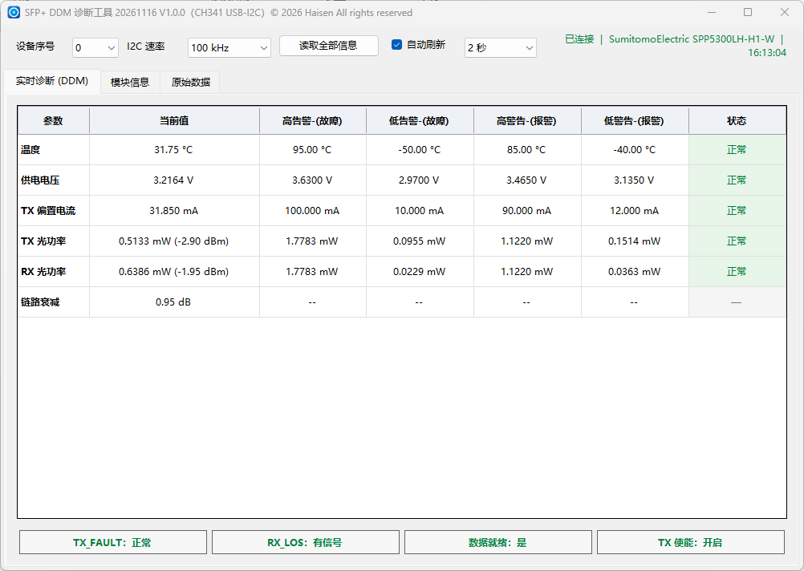
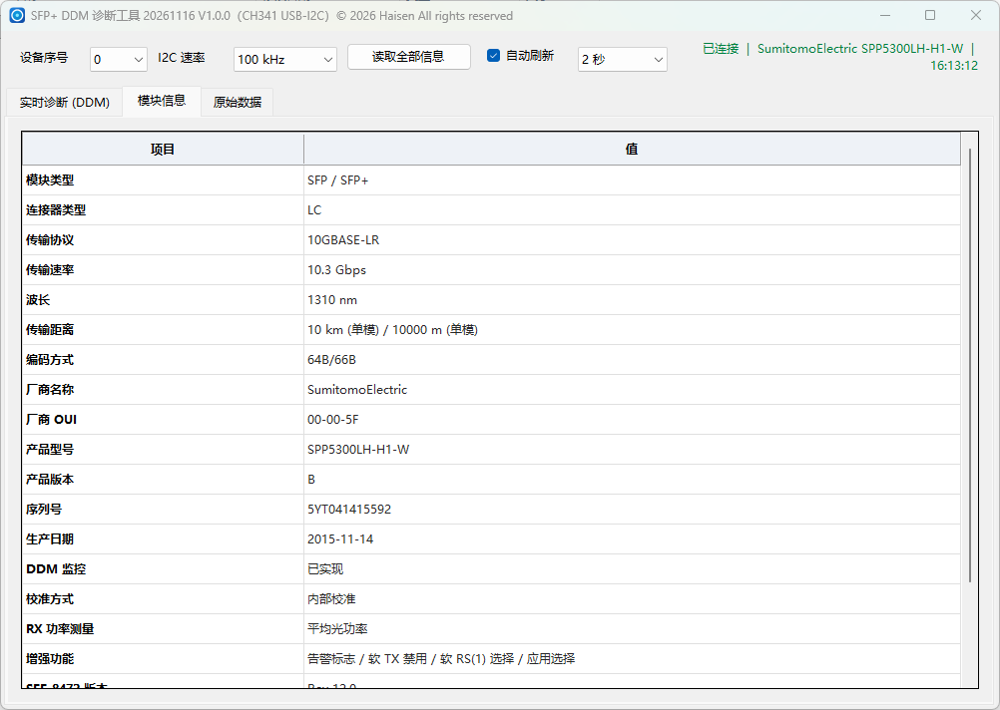
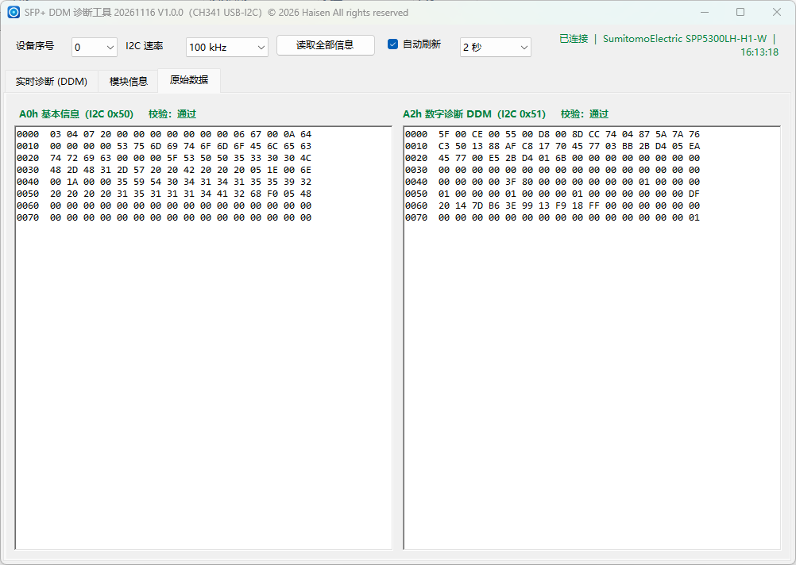
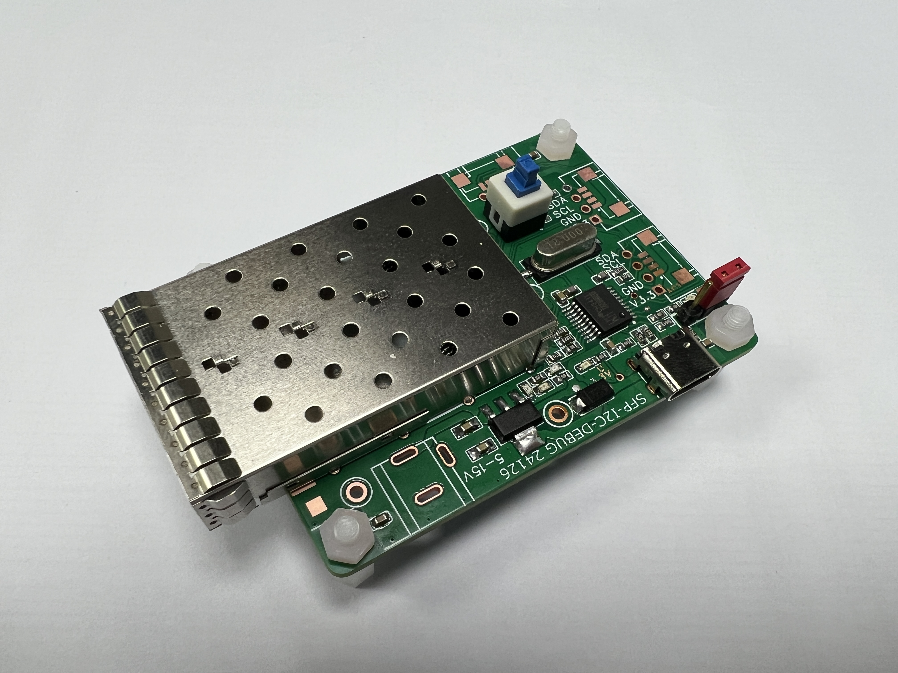
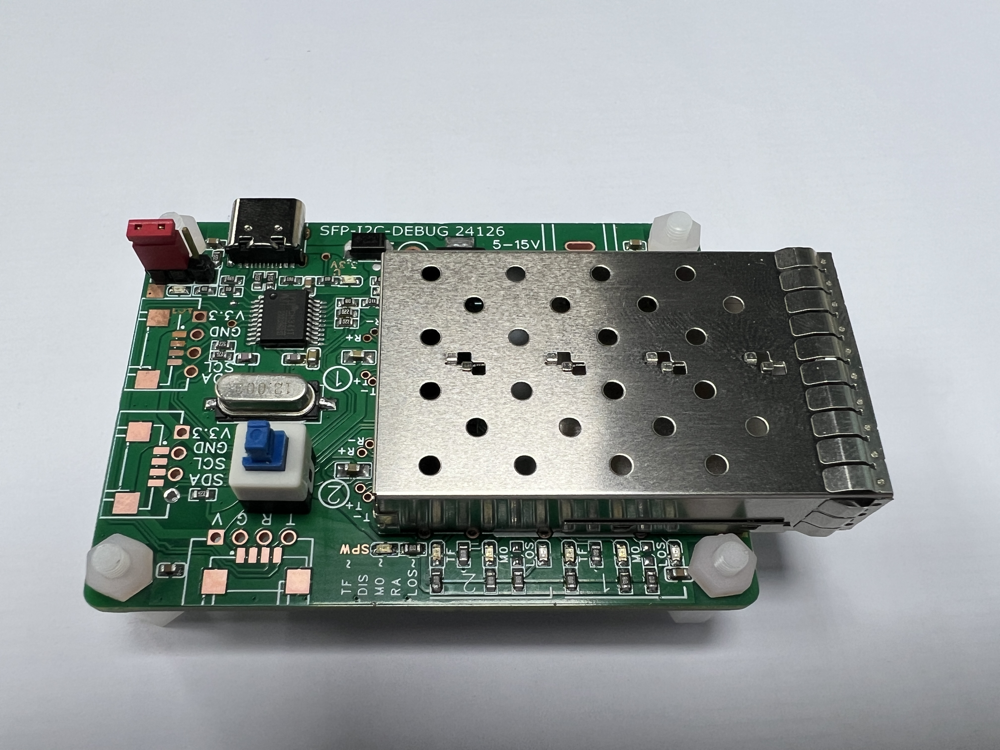
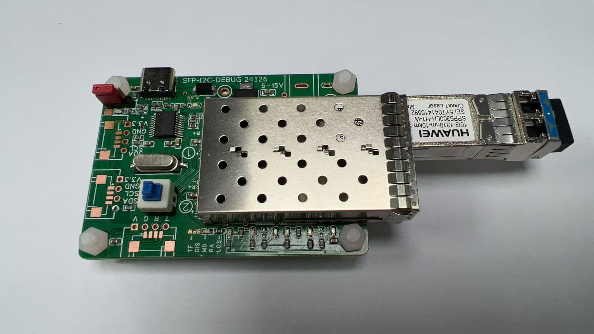
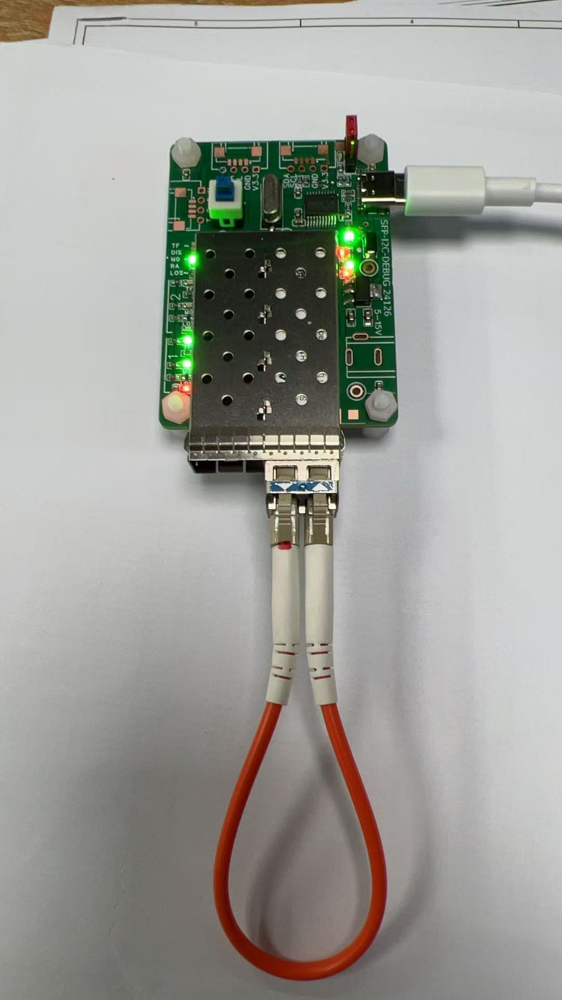

# SFP-DDM
SFP-DDM读取工具

功能说明：
通过USB转I2C芯片CH341T读取SFP模块的DDM信息。
DDM信息：

模块信息：

原始数据：

- 读取 SFF-8472 的 A0h（0x50）和 A2h（0x51）各 128 字节，自动校验 A0h 与 A2h 的校验和
- 实时诊断 ：温度、供电电压、TX 偏置电流、TX/RX 光功率，同时显示高告警、低告警、高警告、低警告，并按阈值自动着色（绿=正常、橙=警告、红=告警）
- 模块信息 ：厂商、型号、序列号、生产日期、波长、速率、协议、传输距离、校准方式等
- 原始数据 ：A0h、A2h 十六进制原始字节
- 支持自动刷新（1、2、5 秒），设备序号和 I2C 速率可选（20、100、400 kHz
内部校准和外部校准模块都能解析，其中外部校准模块用斜率、偏移和 RX 四项多项式换算

使用注意：程序直接双击运行，依赖系统已安装的 CH341 驱动（`CH341DLLA64.DLL` ）

硬件来自
https://oshwhub.com/zengyunjlc/sfp_debugv2?jspm=hub.ss.lb.gc14&jlc_vid=TlRdVgdTRVRaBAcEElgPAwdfRlhaUQcHFlYKBgUEE1IxVlNfQ1lfXlJVQlVeVjtWKAkaExQVTU5BEBMRWQsCBEoFGAw%3D
已做小修改，已适应自有元件，硬件PCBA 已验证

PCB 仿真图

.png)

.png)

